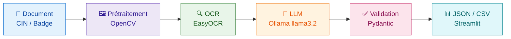

<div align="center">


# 📄 Smart Document Extractor

### Extraction intelligente d'informations à partir de pièces justificatives


</div>

---

## 📌 Présentation

**Smart Document Extractor** est un pipeline **local, modulaire et reproductible** qui extrait des informations structurées à partir de documents justificatifs (cartes nationales d'identité **CIN**, badges, etc.).

Il combine :

| 🧩 Brique | 🛠️ Outil | 🎯 Rôle |
|:---|:---|:---|
| 🖼️ Prétraitement | **OpenCV** | Nettoyage de l'image (niveaux de gris + CLAHE) |
| 🔍 OCR | **EasyOCR** | Lecture du texte brut + cadres de détection |
| 🤖 Extraction | **Ollama** (`llama3.2`) | Compréhension du texte et sortie JSON |
| ✅ Validation | **Pydantic** | Garantie de la structure des 5 champs |
| 🌐 Interface | **Streamlit** | Visualisation, correction et export |

> [!NOTE]
> Tout le traitement s'exécute **en local** : aucune donnée personnelle n'est envoyée vers un service externe.

---

## 🔄 Fonctionnement du pipeline



---

## 🗂️ Architecture du projet

```text
smart-document-extractor/
├── 📂 data/                        # Documents sources (CIN, badges) — ignoré par Git
├── 📂 outputs/                     # Résultats générés — ignoré par Git
│   ├── cleaned_images/             #   Images nettoyées
│   ├── ocr_visualisations/         #   Images avec cadres de détection
│   ├── ocr_resultats.txt           #   Rapport texte de l'OCR
│   └── extracteur/
│       ├── cin/                    #   JSON des cartes d'identité
│       └── badges/                 #   JSON des badges
├── 📂 src/
│   
│   ├── 🐍 preprocessor.py          # Prétraitement (niveaux de gris + CLAHE)
│   ├── 🐍 ocr_engine.py            # Texte brut + cadres de détection (EasyOCR)
│   └── 🐍 llm_extractor.py         # Structuration JSON via Ollama + Pydantic
├── 🐍 app.py                       # Interface web (Streamlit)
├── 📄 requirements.txt             # Dépendances Python
├── 📄 .gitignore
└── 📄 README.md
```

---

## ⚙️ Prérequis et installation

### 1️⃣ Cloner le dépôt et créer l'environnement virtuel

```bash
git clone https://github.com/<votre-utilisateur>/smart-document-extractor.git
cd smart-document-extractor

python -m venv .venv
```

Activer l'environnement virtuel :

<table>
<tr>
<td>🪟 <b>Windows (PowerShell)</b></td>
<td>🐧🍎 <b>Linux / macOS</b></td>
</tr>
<tr>
<td>

```powershell
.venv\Scripts\activate
```

</td>
<td>

```bash
source .venv/bin/activate
```

</td>
</tr>
</table>

### 2️⃣ Installer les dépendances Python

```bash
pip install -r requirements.txt
```

### 3️⃣ Installer Ollama et télécharger le modèle

1. Téléchargez et installez Ollama depuis [**ollama.com**](https://ollama.com).
2. Vérifiez que le service tourne en arrière-plan, puis téléchargez le modèle :

```bash
ollama pull llama3.2
```

> [!TIP]
> Si votre PC est puissant, vous pouvez tester un modèle plus précis, par exemple `qwen2.5:7b`, en modifiant le nom du modèle dans `src/llm_extractor.py`.

---

## ▶️ Instructions d'exécution

> [!IMPORTANT]
> Chaque module de `src/` peut être lancé **indépendamment** pour tester et valider chaque étape du pipeline.

### 🟣 Étape 1 — Prétraitement des images (OpenCV)

Passe les images en niveaux de gris, améliore le contraste (CLAHE) et enregistre le résultat dans `outputs/cleaned_images/`.

```bash
python src/preprocessor.py
```

### 🟢 Étape 2 — Extraction du texte brut (EasyOCR)

Lit le texte des images prétraitées, génère les visualisations avec cadres dans `outputs/ocr_visualisations/` et sauvegarde le rapport dans `outputs/ocr_resultats.txt`.

```bash
python src/ocr_engine.py
```

### 🟠 Étape 3 — Extraction structurée des champs (Ollama + Pydantic)

Analyse le texte OCR avec le modèle local et produit les 5 champs demandés. Les fichiers JSON sont classés dans `outputs/extracteur/cin/` et `outputs/extracteur/badges/`.

```bash
python src/llm_extractor.py
```

### 🔴 Étape 4 — Lancer l'interface web (Streamlit)

Importez un document, inspectez les étapes visuelles, vérifiez ou ajustez les champs extraits, puis exportez en JSON ou CSV.

```bash
streamlit run app.py
```

---

## 🧾 Champs extraits

Chaque document analysé produit une structure JSON **validée par Pydantic** :

| 🏷️ Champ | 📝 Description | 💡 Exemple |
|:---|:---|:---|
| 👤 `nom` | Nom de famille de la personne principale | `BEN SALAH` |
| 🧑 `prenom` | Prénom de la personne principale | `Ahmed` |
| 📅 `date` | Date pertinente associée au document | `15/03/1995` |
| 🔢 `numero_document` | Numéro de pièce d'identité, de badge ou référence | `01234567` |
| 🏛️ `organisme_emetteur` | Autorité, institution ou organisme émetteur | `République Tunisienne` |

<details>
<summary>📦 <b>Exemple de sortie JSON</b> (cliquer pour déplier)</summary>

```json
{
  "nom": "BEN SALAH",
  "prenom": "Ahmed",
  "date": "15/03/1995",
  "numero_document": "01234567",
  "organisme_emetteur": "République Tunisienne"
}
```

</details>

---

## 🛠️ Dépannage

<details>
<summary>❌ <b>Erreur « connection refused » avec Ollama</b></summary>

L'application Ollama n'est pas lancée. Ouvrez-la, puis relancez la commande.

</details>

<details>
<summary>🐢 <b>L'OCR est lent</b></summary>

EasyOCR sur CPU prend entre 5 et 20 secondes par image. Au premier lancement, les modèles sont aussi téléchargés (connexion internet nécessaire, une seule fois).

</details>

<details>
<summary>🔤 <b>Le texte arabe est mal lu</b></summary>

EasyOCR ne combine pas l'arabe et le français dans un même lecteur. Utilisez deux passes OCR (`fr`+`en` puis `ar`+`en`) et fusionnez les textes avant l'envoi au LLM.

</details>

---

## 🔒 Confidentialité

> [!WARNING]
> Les dossiers `data/` et `outputs/` contiennent des **données personnelles**. Ils sont exclus de Git via `.gitignore` : ne les publiez jamais sur GitHub.

---

<div align="center">

Fait avec ❤️ en Python · 🟦 OpenCV · 🟩 EasyOCR · 🟧 Ollama · 🟥 Streamlit

</div>
---

## 👩‍💻 À propos de l'auteure

**Takwa Labidi  étudiante en troisième année  Licence en Mathématiques et Informatique (L3) à la Faculté des Sciences de Tunis (FST), Université de Tunis El Manar.**


🔗 **GitHub :** [@takwalabidi](https://github.com/takwalabidi)

---

